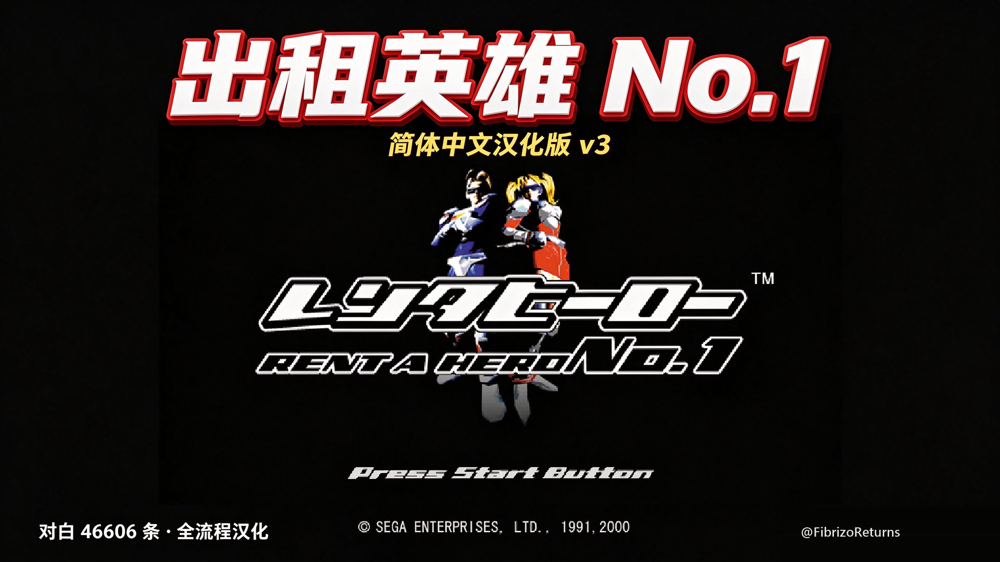

# 出租英雄 No.1 · Dreamcast 简体中文汉化 v3

**Rent-A-Hero No.1 (レンタヒーロー No.1) — Simplified Chinese Fan Translation v3**

SEGA · Dreamcast · 2000 年日版（HDR-0074） · 简体中文 · 2026.11 · 制作：[@FibrizoReturns](https://space.bilibili.com/)

> 本仓库只放**说明文档、校验值、截图与版本信息**，不包含游戏本体或任何原版/成品镜像。
> 补丁与成品盘请从发布页获取，并请自备正版原盘。

**English: [README_EN.md](README_EN.md)**



---

## 这是什么

2000 年 Dreamcast 上的《出租英雄 No.1》是世嘉 1991 年 MD 名作《出租英雄》的 3D 重制版：
一个 16 岁少年，白天打零工、接单跑腿、和街坊聊天，晚上变身穿装甲去打架。

它和《莎木》是同期、同平台、同一种"在城市里过日子"的骨架，但气质相反——
莎木是"严肃的日常"，出租英雄是"日常的荒诞"，台词全是梗，笑点密集。
海外媒体给它的定位就是：**《莎木》的幽默版孪生兄弟**（a humorous, tongue-in-cheek counterpart to Shenmue）。

喜欢莎木那座城市的人，会喜欢这里的街道；受不了莎木节奏的人，会喜欢这里的节奏。

## 制作阵容（两拨人，别弄混）

| | 1991 MD 原作 | 2000 DC 重制版（本作） |
|---|---|---|
| 开发 | Sega AM2 | Aspect |
| 发行 | SEGA | SEGA |
| 制作人 / 监督 | 铃木裕（Yu Suzuki），设计 Keiji Okayasu | 荒井俊明（Toshiaki Arai） |

战斗引擎直接沿用世嘉街机《Spikeout》（1998，MODEL3 基板）的引擎源码。
于是有一条很实在的技术血脉：**《VR战士》→《VF3》→《Spikeout》→《出租英雄 No.1》**，
同一批人在同一套 AM 系格斗框架上迭代，所以角色骨架、动作轨道、招式判定表的数据格式高度同源。
这也是为什么一个"打工 RPG"能打出街机级的连招手感和打击判定——它骨子里是台清版格斗机。

（《莎木》是另一条线：AM2 自己的 FREE 体系，全 3D 场景 + 写实动作。同厂，不同引擎。）

## 汉化了什么

| 区块 | 数量 |
|---|---|
| 剧情对白（含分支、旁白、内心独白） | 46,606 条 |
| 界面文本（菜单、提示、按钮、状态栏） | 344 条 |
| 道具与装备说明 | 806 条 |
| 受付（打工接单）委托单 | 33 条 |
| 店员对话 + 技名 | 370 条 |
| 游戏内邮件 | 全篇 |
| 字库 | 重建为 3,292 字简体码表，逐字校对，无缺字、不借槽 |

- 早期版本用近义字顶替的字，已按原版规格重绘后改回本字
- 招牌 / 店名 / 游戏名（QTE、MJQ、YOU、Maison 石川、卡拉 OK）按原样保留英文并转全角

## 已知问题（诚实说明）

- 菜单「参数」页仍是日文：页签（アイテム／カギ／バトル／プレゼント）、五档台词速度、
  左列三个开关标签。这些是**盘内的多边形几何文字**，不是字库、不是贴图，
  替换需要重排几何数据，本版没有处理。原因见 [`docs/技术说明.md`](docs/技术说明.md)。
- 存档 / 读档界面的提示文本保留日文（按汉化规范不动存档相关数据）
- 曲名保留原文；起名页保持日版样式
- 开场 2D 像素风过场、谜之便条的谜面等走独立脚本的文本，不在文本池内，保留原文

## 下载

- **发布视频（B 站）**：[【DC汉化】《出租英雄 No.1》简体汉化 v3：莎木的搞笑版孪生兄弟](https://www.bilibili.com/video/BV1cwyHztEvh/)
- **成品盘（百度网盘）**：[出租英雄No1_简体汉化_成品 V3RUN](https://pan.baidu.com/s/1uVhPdS8dgKTvV8wQxIM8EQ?pwd=qdpa) 提取码 `qdpa`

本仓库不存放任何镜像文件，下载一律走上面两个入口。拿到后请先按 [`checksums.txt`](checksums.txt) 核对 `track03.bin`。

## 安装

见 [`INSTALL.md`](INSTALL.md)。一句话：解压后 4 个文件放同一目录 → Flycast 打开 `.gdi`。

## 校验值

成品盘 `track03.bin`（数据轨）：

```
MD5  27180546005E35BC30B9A2C6B9BC11DD
大小 1185760800 字节
```

详见 [`checksums.txt`](checksums.txt)。不一致说明下载或解压损坏，请重新获取。

## 为什么全世界的翻译这么少

这游戏的汉化难度大概是《莎木》的四倍。不是因为世嘉加密——
是世嘉把 Dreamcast 的机能榨到了极限，很多地方靠硬件极限操作撑起来，
数据结构跟运行时行为绑死，改一处连带修一片，能下手的入口极少。

按发布时间，这游戏的翻译目前只有四种：

| 版本 | 时间 | 作者 |
|---|---|---|
| 日文原版 | 2000.05 | SEGA / Aspect |
| 英文补丁 | 2023 | Rent-A-Modders（VincentNL 等） |
| 韩文补丁 | 2026.09.10（v0.5）→ 2026.09.24（v0.8） | 흐음 |
| 简体中文 | 2026.11 | 本作 |

## 致谢

- SEGA、Aspect，以及 AM2 那些街机与家用机作品，是这份热情的来源
- Rent-A-Modders 团队（VincentNL 等）的英文补丁，让更多人先认识了这部作品
- 所有做过 DC 汉化工具与文档的同好

## 版权

本汉化为民间爱好者作品，仅供学习交流，**请支持正版**。
游戏版权归 SEGA 及相关权利人所有。本仓库不提供、也不会提供任何原版或成品镜像。

---

## English summary

A Simplified Chinese fan translation of *Rent-A-Hero No.1* (SEGA Dreamcast, Japan 2000, HDR-0074),
made by @FibrizoReturns, released 2026.11.

This repository contains **documentation, checksums and screenshots only** — no game data and no
pre-patched disc image. Dialogue, menus, item descriptions, job requests, shop/skill names and
in-game e-mail are translated; the font was rebuilt to the original specification as a full
Simplified Chinese set. Known limitation: the "Parameter" menu page uses baked polygon geometry
text, which is out of scope for this release.

Tested on Flycast (Windows). Please own the original disc.
